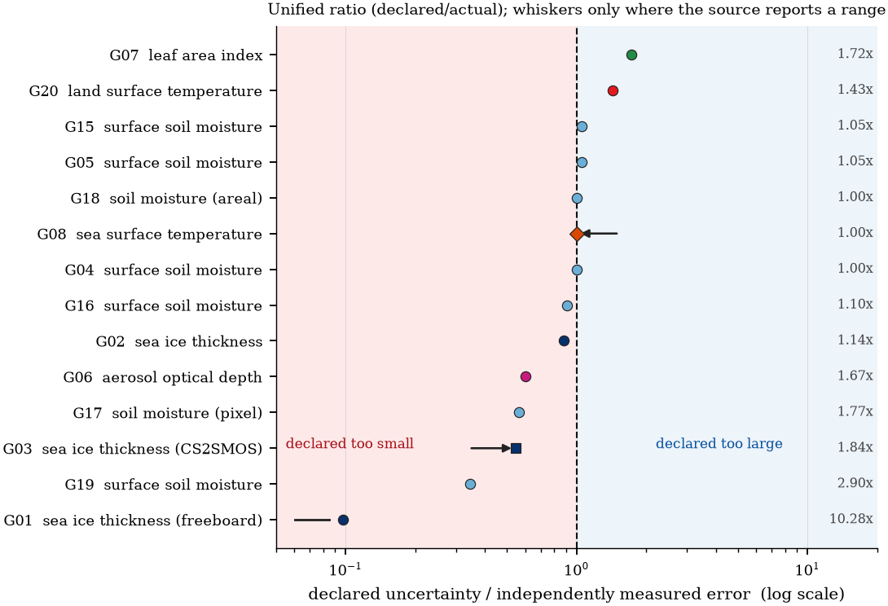

# Declared versus measured uncertainty in Earth observation products

  
  

  

Nearly every satellite product ships a declared uncertainty, and that number is
rarely checked against independent validation. This repository is the audit: 50
declarations across 16 variable families, a five-condition admission checklist, 55
verification records and a 17-row correction ledger a user can apply directly.

*Declared divided by measured, against the prior-dependence score. Most declarations
under-report; the largest departures are all under-reports.*

## What it settles

| quantity | value |
|---|---|
| declared objects | 50, in 16 variable families |
| auditable under all five conditions | 8 (16 %) |
| verification records | 55 (27 inherited, 28 added) |
| median ratio, five object-matched grade-A records | 0.879 (0.544–1.053) |
| geometric mean, seven fully admitted | 0.888 (95 % CI 0.627–1.140) |
| geometric mean, all ratio-definable | 0.735 (0.496–1.011) |

## Contents

    data/p3_dataset.csv           50 objects × 59 columns
    data/column_dictionary.csv    field-by-field definition of all 59 columns
    data/p3_verification_log.csv  55 records: locator, quoted reading, DOI status
    data/p3_declared_ledger.csv   the 17-row correction ledger
    data/p3_reconciliation.csv    each object against the inherited core table
    data/claims.json              every number the article quotes
    code/audit_claims.py          repairs locators, derives the ledger, audits the text
    code/analysis.py, figures.py, make_tables.py, build_dataset.py
    tex/, figures/                generated tables and figures

## Quick start

    pip install numpy pandas scipy matplotlib
    python code/audit_claims.py --write

The `--write` step is idempotent (the files it edits are backed up once to
`data/r12_baseline/`). Adding `--check-text` asserts 20 headline values against the
manuscript; that flag needs the article source, so it runs in the paper package.

## Reading the checklist

A declaration is auditable when it states a number (C1), ties it to a locator and a
reading (C2), refers to the same product and the same statistic (C3), states the
support at which it was established (C4), and has an independent measured error at
that support (C5). The ledger's recommendation is derived from the verdict by one
rule, so it cannot recommend a record the audit itself refuses.

## The paper

*Declared but unverifiable: an audit of uncertainty declarations in Earth observation
products* — submitted to the **International Journal of Remote Sensing**.

## Licence and citation

Code MIT (`LICENSE`), audit data CC BY 4.0 (`DATA_LICENSE`). Cite the article and this
repository — see `CITATION.cff`.

---
[中文说明](README.zh-CN.md)
