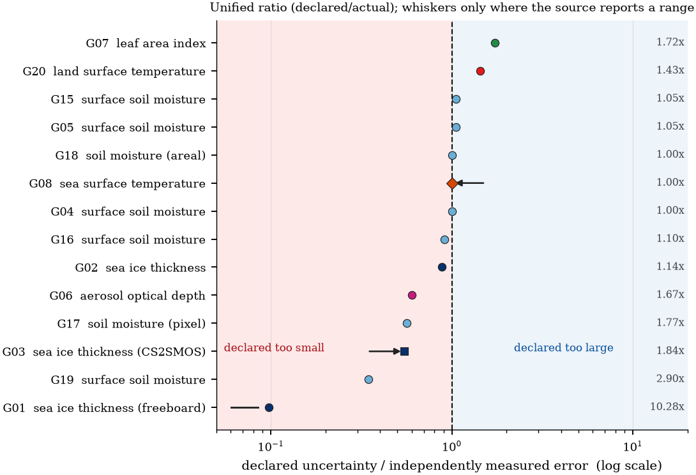

# 地球观测产品：声明不确定度与实测误差

  

几乎每个卫星产品都附带声明不确定度，而这个数字很少被拿去与独立验证对照。本仓就是这份审计：
16 个变量族的 50 条声明、五条准入条件、55 条核验记录，以及 17 行可直接使用的更正台账。

*声明值除以实测值，对先验依赖评分。多数声明低报；偏离最大的几例全是低报。*

## 它确定了什么

| 量 | 数值 |
|---|---|
| 声明对象 | 50 个，覆盖 16 个变量族 |
| 同时满足五条可审计条件 | 8 个（16 %） |
| 核验记录 | 55 条（继承 27，新增 28） |
| 五个对象匹配 A 级记录的中位比值 | 0.879（0.544–1.053） |
| 七条完全准入的几何均值 | 0.888（95 % CI 0.627–1.140） |
| 全部可定比值的几何均值 | 0.735（0.496–1.011） |

## 目录

    data/p3_dataset.csv           50 个对象 × 59 列
    data/column_dictionary.csv    59 列逐字段定义
    data/p3_verification_log.csv  55 条记录：定位符、引文、DOI 状态
    data/p3_declared_ledger.csv   17 行更正台账
    data/p3_reconciliation.csv    每个对象与继承核心表的对照
    data/claims.json              论文引用的每个数字
    code/audit_claims.py          回填定位符、推导台账、审计正文
    code/analysis.py, figures.py, make_tables.py, build_dataset.py
    tex/, figures/                生成的表与图

## 快速开始

    pip install numpy pandas scipy matplotlib
    python code/audit_claims.py --write

`--write` 是幂等的（它会编辑的两个文件先备份到 `data/r12_baseline/`）。加 `--check-text`
会把 20 个头号数字与手稿逐条比对；该开关需要论文源码，因此在论文包内运行。

## 怎么读这张清单

一条声明可审计，须同时满足：给出数值（C1）、能定位到具体出处并有读数（C2）、指向同一产品与同一
统计量（C3）、说明该 sigma 建立时的支撑尺度和平均窗口（C4）、在该支撑上有独立的实测误差（C5）。
台账的推荐由裁决按同一条规则推出，因此它不会推荐审计自己拒绝的记录。

## 对应论文

*Declared but unverifiable: an audit of uncertainty declarations in Earth observation
products*，拟投 **International Journal of Remote Sensing**。

## 许可与引用

代码 MIT（`LICENSE`），审计数据 CC BY 4.0（`DATA_LICENSE`）。引用见 `CITATION.cff`。

---
[English](README.md)
